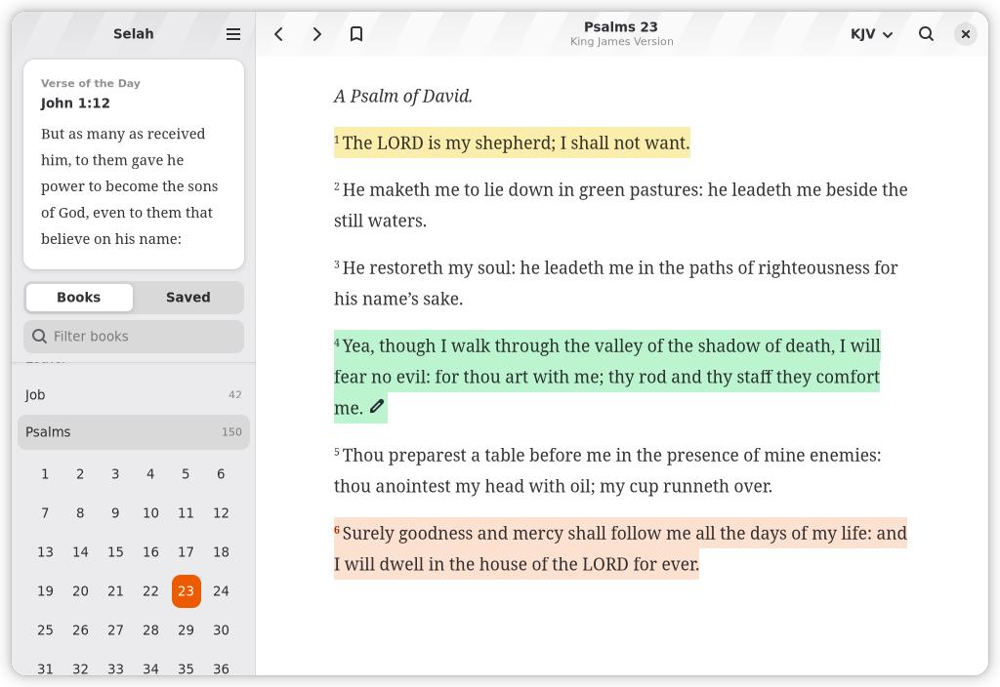
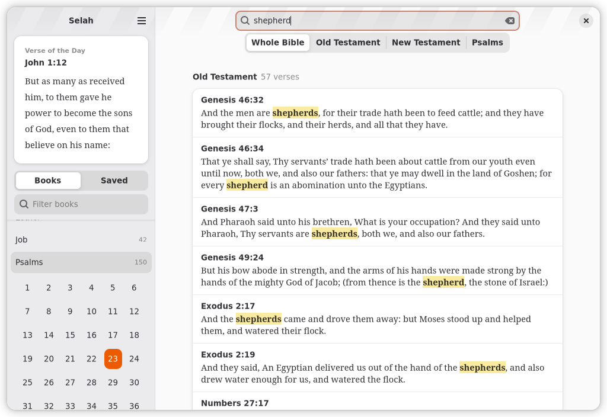
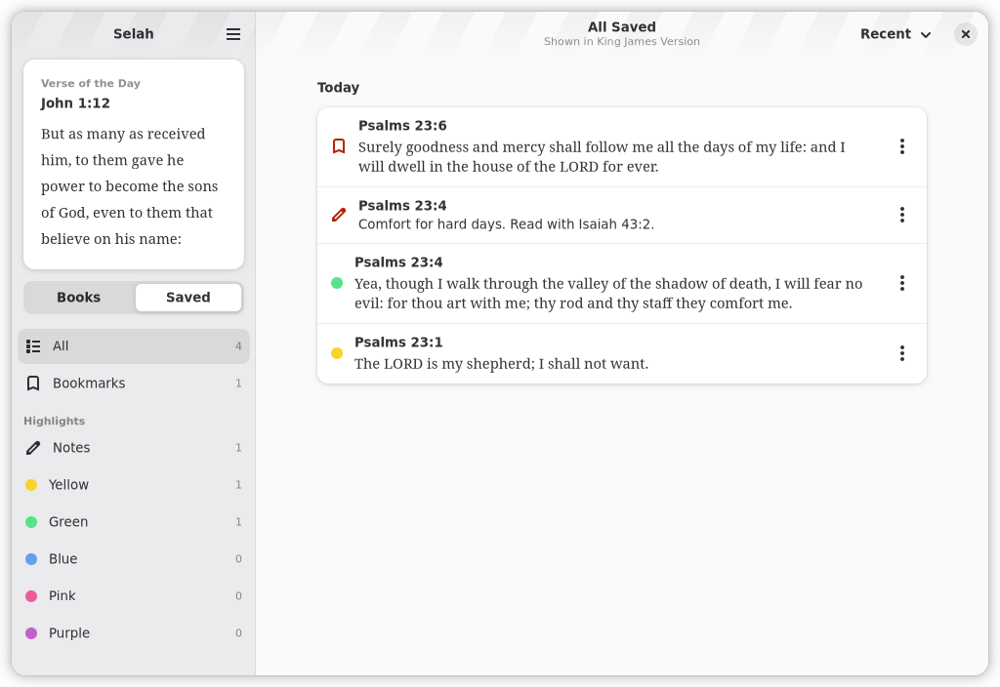
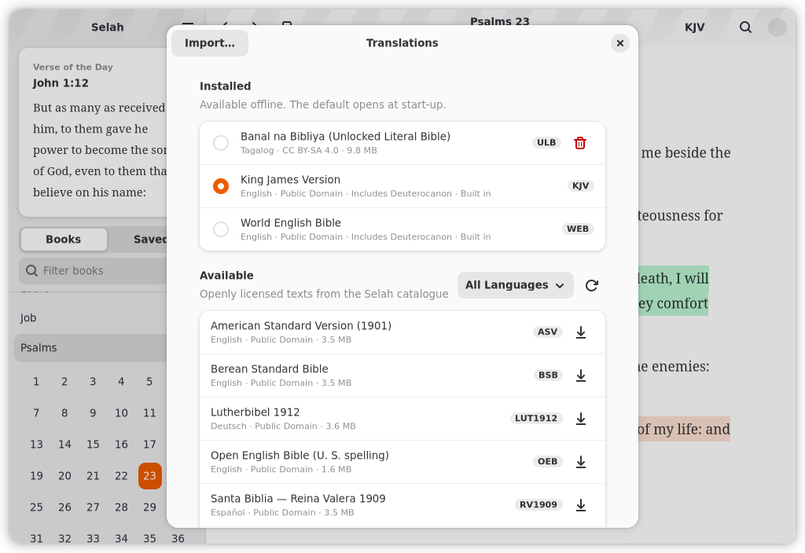
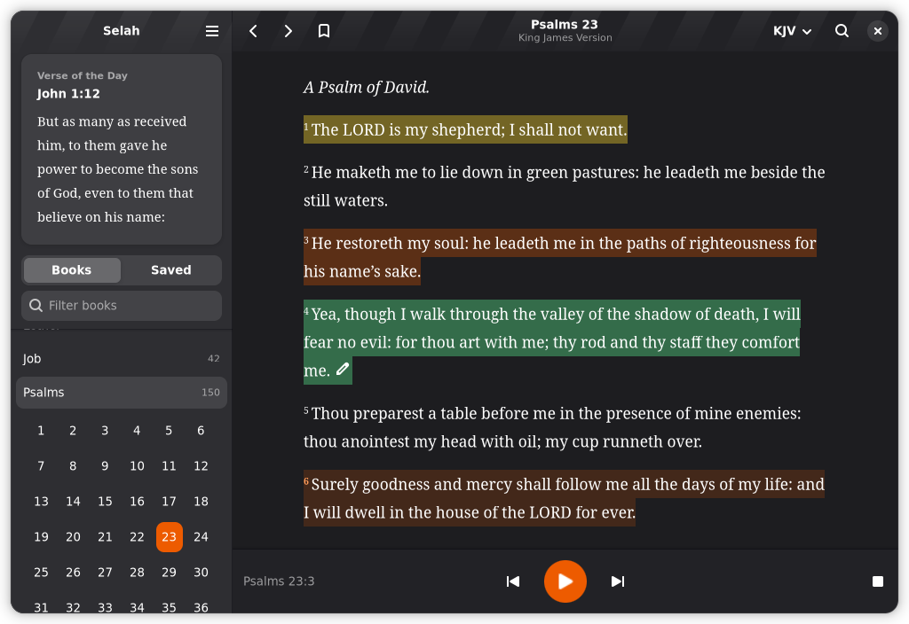

# Selah

**Read the Bible offline.**

Selah is a calm, local-first Bible reader for GNOME. It works from the
first launch without a connection, keeps your highlights, bookmarks and
notes on your device, and fits both desktops and phones.



## Features

- **Ready offline.** The King James Version and the World English Bible
  are built in.
- **More translations.** Download openly licensed translations from the
  [Selah catalogue](https://github.com/CJTS15/selah-catalog), or import a
  `.selah` package. Every file is checked before it is installed.
- **Search.** Type words to search the whole Bible, one testament or one
  book, or type a reference such as “Ps 23” or “Jn 3:16” to go straight
  there.
- **Highlights, bookmarks and notes.** Five highlight colours, bookmarks
  and notes, all listed on the Saved page. They follow you when you switch
  translations, even ones that number verses differently.
- **Verse of the day** at the top of the sidebar.
- **Read aloud.** Selah reads the chapter verse by verse in the
  translation's language (most languages are supported) and highlights the
  verse being read. Play, pause and skip from the keyboard.
- **Comfortable reading.** Choose the font, text size, line spacing,
  paragraphs or one verse per line, verse numbers, and a light or dark
  style.
- **For everyone.** Right-to-left translations, keyboard navigation,
  screen reader labels, high contrast and large text support.

| Search | Saved |
| --- | --- |
|  |  |

| Translations | Read aloud |
| --- | --- |
|  |  |

## Privacy

Selah has no accounts, no analytics and no tracking. Your highlights,
bookmarks and notes stay on your device. Selah only goes online to fetch
the translation catalogue and the translations you choose to download.

## Translations

Bible texts in Selah are in the public domain or under open licences that
allow sharing. Each translation's licence and attribution are shown in the
Translations dialog and under **About Selah → Legal**.

- The built-in King James Version and World English Bible come from
  [eBible.org](https://ebible.org/) (the KJV courtesy of the CrossWire
  Bible Society and eBible.org).
- The catalogue is built weekly from eBible.org by
  [selah-catalog](https://github.com/CJTS15/selah-catalog), which keeps
  only openly licensed texts. To ask for a translation, open an issue
  there.

## Install

Selah is not on Flathub yet. Until it is, build it from source.

## Build from source

Selah is written in Rust with GTK 4, libadwaita and Blueprint, built with
Meson and packaged with Flatpak.

The easiest way is [GNOME Builder](https://apps.gnome.org/Builder/): clone
the repository, open it and press **Run**.

From a terminal, with
[flatpak-builder](https://docs.flatpak.org/en/latest/flatpak-builder.html)
(`org.flatpak.Builder` from Flathub) and the GNOME 51 SDK installed:

```sh
git clone https://github.com/CJTS15/selah.git
cd selah
flatpak run org.flatpak.Builder --user --install --force-clean \
  build-dir build-aux/io.github.cjts15.Selah.Devel.json
flatpak run io.github.cjts15.Selah.Devel
```

See [CONTRIBUTING.md](CONTRIBUTING.md) for the checks to run before you
open a pull request.

## Contributing

Bug reports, ideas, translations and code are welcome. Please read
[CONTRIBUTING.md](CONTRIBUTING.md). Everyone taking part follows the
[Code of Conduct](CODE_OF_CONDUCT.md).

## Licence

Selah is free software under the
[GNU General Public License, version 3 or later](LICENSE).
Bible texts keep their own licences, shown in the app.
